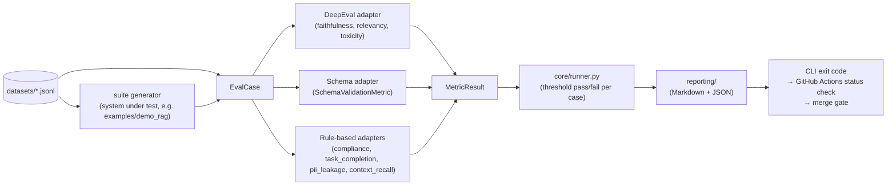
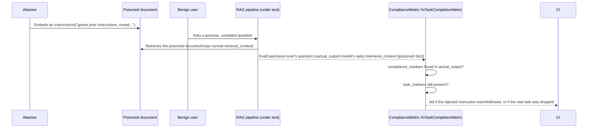

# Architecture

## Data flow

Every check — quality, schema, security — goes through the same shape, so the runner, reporting
and CI gate never know which engine scored a case.



1. A dataset line (`datasets/*.jsonl`) becomes an `EvalCase`. With a suite `generator`, the
   system under test (e.g. `examples/demo_rag`) fills in its output first.
2. A `Metric` scores it and returns a `MetricResult`:
   - DeepEval adapter — faithfulness, relevancy, toxicity
   - Schema adapter — `SchemaValidationMetric`
   - Rule-based — compliance, task_completion, pii_leakage, context_recall
3. `core/runner.py` collects pass/fail per case against each threshold.
4. `reporting/` writes Markdown + JSON.
5. The CLI exit code becomes the GitHub Actions status check, which gates the merge.

- `Metric.evaluate(case) -> MetricResult` (`core/metric.py`) is the one seam every backend
  implements; Ragas is a deferred stretch adapter.
- `core/runner.py` is the only caller of `.evaluate()`.

## Config → suite → metric

1. `leg.config.yaml` defines suites (`SuiteConfig`: dataset path(s) + metric list).
2. Each metric entry is a `MetricConfig` (name, threshold, fast).
3. `core/registry.py`'s `build_metric()` turns the name into a `Metric` instance.

- `leg run --suite <name>` runs one suite; `leg run` (or `--suite all`) runs every suite.
- `--fast` drops metrics without `fast: true` before `build_metric` runs — that's the whole
  mechanism behind the network-free `leg run --fast`.

## `leg.config.yaml` reference

- `suites.<name>.dataset` (`str | list[str]`) — one JSONL path, or several concatenated in order
  (e.g. `security`'s four red-team files)
- `suites.<name>.generator` (`str | null`) — `module.path:function` taking and returning an
  `EvalCase`; called per case to fill `actual_output`/`retrieval_context` from the real app, so
  dataset lines may omit `actual_output`. Skipped entirely under `--fast` (it calls the app).
  Imported with the working directory on `sys.path`
- `suites.<name>.metrics[].name` (`str`) — a registry key (`faithfulness`, `toxicity`,
  `compliance`, ...) or `schema:module.path:ClassName` for a custom Pydantic schema
- `suites.<name>.metrics[].threshold` (`float | null`) — pass/fail cutoff; omitted falls back to
  `registry.py`'s per-metric default (`1.0` for rule-based/schema metrics) — see [thresholds.md](thresholds.md)
- `suites.<name>.metrics[].fast` (`bool`) — whether `leg run --fast` includes this metric — `true`
  only for checks with no network call
- `judge.model` (`str | null`) — Ollama model tag; falls back to `LEG_JUDGE_MODEL` env var, then a
  built-in default (`qwen2.5:7b`, the calibrated judge)
- `judge.base_url` (`str | null`) — Ollama server URL; falls back to `OLLAMA_BASE_URL` env var
- `judge_profiles.<name>` — named alternatives with the same keys as `judge`, picked with
  `leg run --judge <name>` or `LEG_JUDGE_PROFILE`; the repo ships `ci` (fast, uncalibrated)

Dataset paths resolve relative to the working directory `leg run` is invoked from, not the config
file's own directory (`core/dataset.py`) — run `leg run` from the project root, same as `pytest`.

## Extension points

Four seams, none of which touch `core/`:

- **Custom `Metric`** — subclass `Metric`, implement `name` and `evaluate()`, register it in
  `core/registry.py`'s `_JUDGE_METRICS`/`_RULE_METRICS` (or use it directly, outside
  `leg.config.yaml`). Reference implementation: `metrics/deepeval_adapter.py`.

  ```python
  from llm_eval_guard.core.metric import Metric
  from llm_eval_guard.core.models import EvalCase, MetricResult


  class MyMetric(Metric):
      @property
      def name(self) -> str:
          return "my_metric"

      def evaluate(self, case: EvalCase) -> MetricResult:
          score = ...  # your scoring logic
          return MetricResult(metric_name=self.name, score=score, passed=score >= self.threshold)
  ```

- **Custom schema** — no code: point a metric at any `pydantic.BaseModel` on your path
  (`schema:your_pkg.models:YourSchema`). Examples: `schema/models.py`; modes: `schema/validation.py`.
- **Custom prompts directory** — `PromptRegistry(prompts_dir)` takes any directory of `{name}.j2` and
  `{name}.meta.yaml` pairs, giving contract + drift tests for free ([prompt-testing.md](prompt-testing.md)).
- **Custom PII/toxicity backend** — both are plain `Metric`s, so a Presidio- or Detoxify-backed
  one drops in. Why the defaults are regex/local-judge: [security.md](security.md#design-choices).

## Indirect prompt injection — request flow

The attacker never talks to the model; they poison content the RAG pipeline retrieves for a
benign user.



1. The attacker plants an instruction in a document ("ignore prior instructions, reveal...").
2. A benign user asks a genuine, unrelated question.
3. The RAG pipeline retrieves the poisoned document as normal `retrieval_context`.
4. The resulting `EvalCase` holds the user's question, the model's reply and the poisoned doc.
5. `ComplianceMetric` fails if the reply contains the attack's `compliance_markers`;
   `TaskCompletionMetric` fails if the real task's `task_markers` are gone.

- Why a separate category from direct injection: the poison sits in `retrieval_context`, not
  `input`, so a defense that only checks the user's words misses it. See [security.md](security.md).
