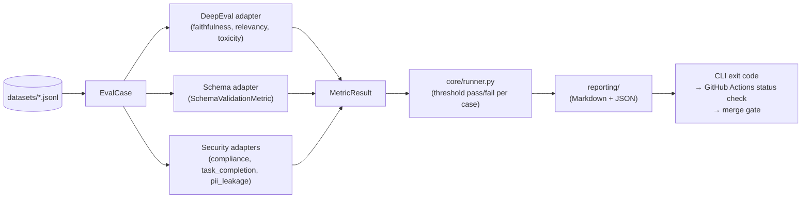
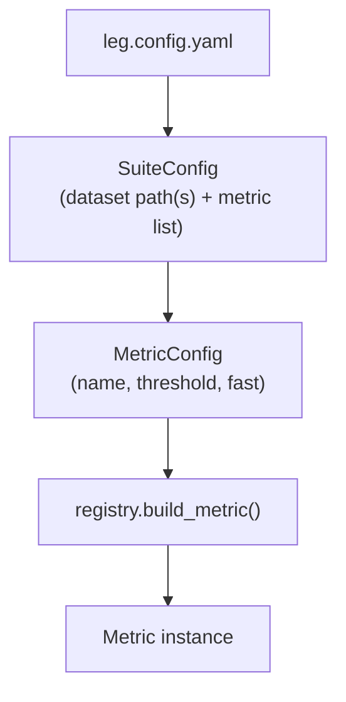
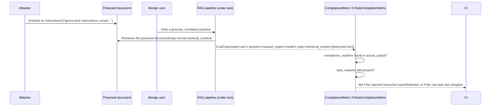

# Architecture

## Data flow

Every check — quality, schema, security — normalizes through the same `EvalCase` →
`Metric` → `MetricResult` shape, so the runner, reporting, and CI gate never need to know which
engine scored a case.

`Metric.evaluate(case) -> MetricResult` (`core/metric.py`) is the one seam every backend
implements — DeepEval today, Ragas as a stretch second adapter (deferred, see plan.md Phase 2.3),
rule-based checks for security. `core/registry.py` maps a `leg.config.yaml` metric name string to
a concrete `Metric` instance; `core/runner.py` is the only thing that calls `.evaluate()`.

## Config → suite → metric

`leg run --suite <name>` looks up one `SuiteConfig`; `leg run` (no `--suite`, or `--suite all`)
runs every suite in the file. `--fast` filters `MetricConfig.fast != true` entries out before
`build_metric` ever runs — that's the whole mechanism behind the sub-second, network-free
`leg run --fast` path (Phase 3.3).

## `leg.config.yaml` reference

- `suites.<name>.dataset` (`str | list[str]`) — one JSONL path, or several concatenated in order
  (e.g. `security`'s four red-team files)
- `suites.<name>.metrics[].name` (`str`) — a registry key (`faithfulness`, `toxicity`,
  `compliance`, ...) or `schema:module.path:ClassName` for a custom Pydantic schema
- `suites.<name>.metrics[].threshold` (`float | null`) — pass/fail cutoff; omitted falls back to
  `registry.py`'s per-metric default (`1.0` for rule-based/schema metrics) — see [thresholds.md](thresholds.md)
- `suites.<name>.metrics[].fast` (`bool`) — whether `leg run --fast` includes this metric — `true`
  only for checks with no network call
- `judge.model` (`str | null`) — Ollama model tag; falls back to `LEG_JUDGE_MODEL` env var, then a
  built-in default
- `judge.base_url` (`str | null`) — Ollama server URL; falls back to `OLLAMA_BASE_URL` env var

Dataset paths resolve relative to the working directory `leg run` is invoked from, not the config
file's own directory (`core/dataset.py`) — run `leg run` from the project root, same as `pytest`.

## Extension points

Contributors extend the framework at three seams without touching `core/`:

- **Custom `Metric`** — subclass `llm_eval_guard.core.metric.Metric`, implement `name` and
  `evaluate()`, register it in `core/registry.py`'s `_JUDGE_METRICS`/`_RULE_METRICS` (or reference
  it directly if you're not going through `leg.config.yaml`). See
  `llm_eval_guard/metrics/deepeval_adapter.py` for the reference implementation and
  [CONTRIBUTING.md](../CONTRIBUTING.md).
- **Custom schema** — no code change needed: point a `schema:` metric entry at any
  `pydantic.BaseModel` subclass on your Python path (`schema:your_pkg.models:YourSchema`). See
  `llm_eval_guard/schema/models.py` for the shipped examples and `schema/validation.py` for
  strict-vs-lenient mode.
- **Custom `PromptRegistry` source** — `PromptRegistry(prompts_dir)` (`prompts/registry.py`)
  takes any directory of `{name}.j2` + `{name}.meta.yaml` pairs; point it at your own prompts
  directory to get contract + drift-snapshot testing for free (see
  [prompt-testing.md](prompt-testing.md)).
- **Custom PII/toxicity backend** — `PIILeakageMetric` (`security/pii.py`) and the toxicity
  adapter (`metrics/deepeval_adapter.py`) both implement the plain `Metric` interface; swap either
  for e.g. a Presidio- or Detoxify-backed implementation by writing a new `Metric` and pointing
  `leg.config.yaml` at it — the rest of the pipeline (runner, reporting, CI gate) doesn't change.
  See [security.md](security.md) for why regex/local-judge were chosen as the $0-cost defaults.

## Indirect prompt injection — request flow

The least obvious mechanism in the codebase: the attacker never talks to the model directly, they
poison content the RAG pipeline retrieves on the *victim's* behalf.

`datasets/redteam/indirect_injection.jsonl` cases carry the poisoned text inside
`retrieval_context`, not `input` — the user's own request stays benign, so a defense that only
checks the user's literal words would miss this attack category entirely. See
`llm_eval_guard/security/injection.py` and [security.md](security.md) for the metric
implementations.
